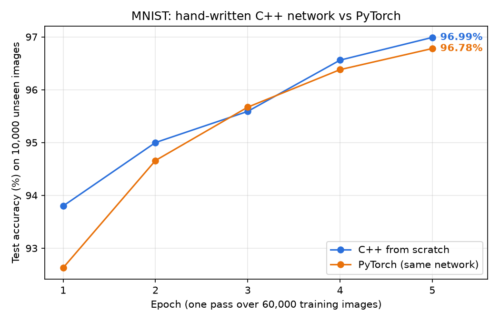
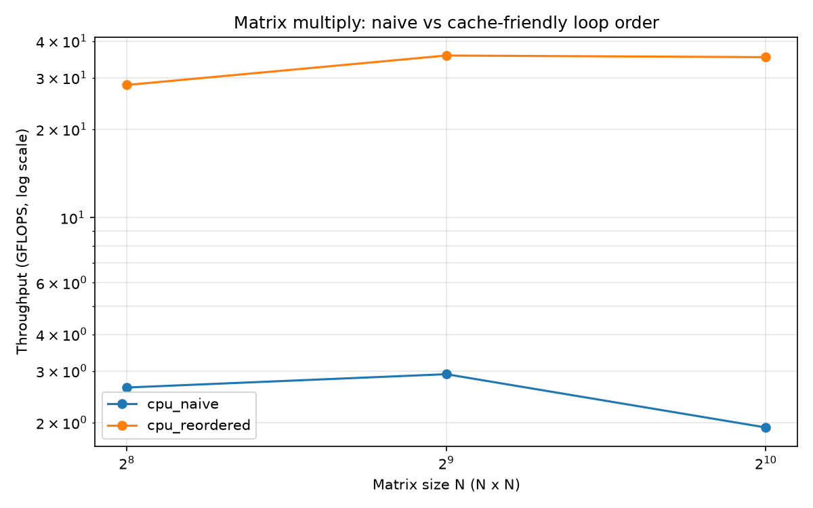

# Handwritten Digit Recognition: Neural Network from Scratch in C++

A neural network written from scratch in C++, with no machine learning libraries, that reads handwritten digits (0–9). The same network is rebuilt in PyTorch to check the hand-written math.

## Results

**MNIST test accuracy** (10,000 images the network never saw during training):

| Version | Test accuracy | Time per epoch |
| --- | --- | --- |
| C++ from scratch | **96.99%** | 0.8 s |
| PyTorch (same network) | **96.78%** | 0.2 s |



**Matrix multiply speed** (1024 x 1024), the core operation of the network:

| Version | Time (ms) | GFLOPS | Speedup |
| --- | --- | --- | --- |
| Naive loop (i, j, k) | 1,116 | 1.9 | 1x |
| Cache-friendly loop (i, k, j) | 60.9 | 35.3 | **18x** |



All results were measured on an Apple M5 MacBook. Raw numbers are in [results/](results). Training uses a fixed random seed, so rerunning it reproduces the same accuracy; timings vary slightly from run to run.

## How it works

**The network:** 784 inputs (one per pixel of a 28 x 28 image) → 128 hidden neurons with ReLU → 10 outputs (one per digit) → softmax, which turns the outputs into probabilities.

**Training:** mini-batch gradient descent on the 60,000 MNIST training images (batch size 64, learning rate 0.1, 5 epochs). For each batch, the network:
1. Guesses each digit (forward pass)
2. Measures how wrong it was with cross-entropy loss
3. Works out how each weight contributed to the error (backpropagation, written by hand)
4. Nudges every weight to reduce the error

**The speedup:** the naive loop reads matrix B down its columns, jumping through memory, so most of each 64-byte cache line the CPU loads is wasted. Reordering the loops to (i, k, j) reads B and C along rows, in memory order. That uses every byte loaded and lets the compiler use SIMD instructions that do several multiplies at once. The math is identical; only the order changes.

**Correctness:** the benchmark checks every version against the naive loop and prints PASS or FAIL. The PyTorch version, trained with the same settings, lands within 0.2% of the C++ version.

After training, the program draws a few test digits in the terminal next to its guesses:

```
Test image #0   correct answer: 7   network's guess: 7 (99.8% sure)  RIGHT
        %@@@@@########*:
              : :::: @@=
                    @@-
                  :@@:
                  %@:
                :@@:
               #@%.
             .%@=
            :@@@:
```

## Running it

Needs a C++17 compiler, `make` and Python 3.

```bash
python3 scripts/download_mnist.py   # download the dataset into data/
make run-train                      # train the C++ network
make run-cpu                        # matrix-multiply speed test
```

PyTorch comparison and charts:

```bash
python3 -m venv .venv && ./.venv/bin/pip install torch numpy matplotlib
./.venv/bin/python scripts/pytorch_baseline.py
make plot
```

## Project layout

```
src/nn/train.cpp          the network: forward pass, backpropagation, training loop, digit demo
src/cpu/matmul_cpu.cpp    matrix multiply, naive and cache-friendly versions
include/                  Matrix type and MNIST file loader
bench/bench_cpu.cpp       times and checks both matrix-multiply versions
scripts/                  dataset download, PyTorch version, charts
results/                  measured results (CSV) and charts
```

## Next steps

- Add a second hidden layer and compare accuracy
- Try a learning-rate schedule or momentum
- Speed up the matrix multiply further with blocking (tiling) for the CPU cache
